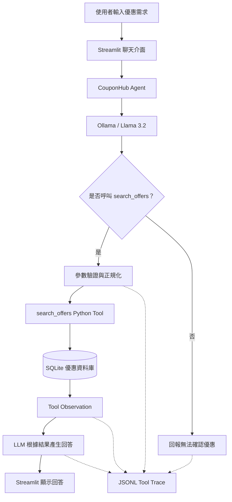

# CouponHub — AI 智慧優惠整合平台

CouponHub 是「人工智慧代理人原理及實務」課程的 AI Agent 專題。

本專案整合商家優惠資訊，提供分類瀏覽、優惠搜尋、人工審核及 AI 智慧優惠查詢功能。

目前為指定作業 2 的可執行 Agent 雛形。

## 1. 專案功能

### 消費者前台
- 美食、購物、商城、外送等動態優惠分類
- 依商家、分類和通路搜尋優惠
- 查看優惠期限、條件及來源網址
- 使用自然語言向 AI 詢問優惠

### 管理後台
- 新增優惠資料
- 人工核准或拒絕優惠
- 編輯優惠並重新送審
- 精確重複優惠檢查
- 動態新增分類

### AI Agent
- 透過 Ollama 執行 Llama 3.2
- 使用 LangChain 進行 Tool Calling
- 呼叫 `search_offers` 查詢 SQLite
- 檢查模型產生的工具參數
- 自動儲存 Agent 執行追蹤

目前尚未實作完整多輪對話記憶及後台 AI 自動解析功能。

## 2. 使用技術

| 技術 | 用途 |
|---|---|
| Python 3.13 | 主要程式語言 |
| Streamlit | 網站前台及管理後台 |
| SQLite | 優惠資料庫 |
| Ollama | 本機 LLM Server |
| Llama 3.2 | AI 語言模型 |
| LangChain | Tool Calling |
| Podman | 應用程式容器化 |
| unittest | 自動化測試 |
| Git / GitHub | 版本管理 |


## 3. Agent 系統架構

本專案使用 LLM Tool Calling 架構，將自然語言理解與實際資料查詢分開處理。



系統只查詢已核准且目前有效的優惠，並將 Agent 決策、工具呼叫、查詢結果及最終回答寫入 JSONL Trace。

目前採用 Tool Calling 架構，尚未實作完整 ReAct 或多步驟規劃 Agent。


## 4. Tool 定義

### search_offers

目的：
查詢 SQLite 中已核准且目前有效的優惠。

輸入：
- merchant：商家名稱，可不指定
- category：優惠分類，可不指定

輸出：
JSON 格式的優惠清單，包含商家、活動標題、
分類、通路、優惠內容、期限、條款與來源網址。

資料限制：
- 只查詢 approved 優惠
- 排除已過期優惠
- 排除缺少有效期間的優惠
- 不直接抓取外部網站的即時優惠

Error Handling：
- 檢查 LLM 產生的參數型別
- 對不符合字串型別的欄位進行正規化
- 查詢錯誤時回傳無法確認的訊息
- 沒有結果時不自行捏造優惠

## 5. 專案結構

```text
CouponHub/
├── app.py
├── admin_app.py
├── Containerfile
├── .containerignore
├── .gitignore
├── requirements.txt
├── README.md
├── src/
│   ├── __init__.py
│   ├── database.py
│   ├── tools.py
│   ├── agent.py
│   ├── import_offer.py
│   └── review_offers.py
└── tests/
    ├── test_search.py
    ├── test_workflow.py
    └── test_agent.py
```

正式 SQLite 資料庫和 Agent Trace 不包含在 GitHub 中。
程式執行後會使用 `data/` 和 `logs/` 資料夾。

## 6. Windows 本機執行

### 6.1 取得專案

```powershell
git clone https://github.com/Peter-ops-tech/CouponHub-AI-Agent.git
cd CouponHub-AI-Agent
```

### 6.2 建立 Python 虛擬環境

```powershell
py -3.13 -m venv .venv
.\.venv\Scripts\python.exe -m pip install -r requirements.txt
```

### 6.3 安裝及啟動 Ollama

先安裝 Ollama，並下載模型：

```powershell
ollama pull llama3.2:latest
```

若 Ollama 服務尚未運作，執行：

```powershell
ollama serve
```

確認模型清單：

```powershell
ollama list
```

### 6.4 啟動消費者前台

```powershell
.\.venv\Scripts\python.exe -m streamlit run app.py --server.port 8501
```

開啟：

http://localhost:8501

### 6.5 啟動管理後台

在另一個終端機執行：

```powershell
.\.venv\Scripts\python.exe -m streamlit run admin_app.py --server.port 8502 --server.address 127.0.0.1
```

開啟：

http://127.0.0.1:8502

注意：管理後台目前沒有登入驗證，
僅供本機開發與展示，不可直接公開部署。

## 7. Podman 容器化執行

### 7.1 環境需求

- Windows 11
- Podman Desktop / Podman Machine
- Windows 主機上的 Ollama
- 已下載 `llama3.2:latest`

本專案將 Streamlit 和 Python Agent 放進 Podman，
Ollama Server 保留在 Windows 主機執行。

容器需能透過以下位址連接 Ollama：

http://host.containers.internal:11434

Windows WSL2 環境可能需要另外設定
內部網路轉發及受限制的防火牆規則。

不建議將沒有登入驗證的 Ollama API
直接公開到網際網路。

### 7.2 建立容器映像檔

```powershell
podman build -t couponhub:hw2 .
```

### 7.3 建立資料夾

```powershell
New-Item -ItemType Directory -Force .\data,.\logs
```

### 7.4 執行消費者前台容器

```powershell
podman run -d --name couponhub-hw2 -p 127.0.0.1:8503:8501 -e OLLAMA_BASE_URL=http://host.containers.internal:11434 -v "${PWD}\data:/app/data" -v "${PWD}\logs:/app/logs" couponhub:hw2
```

開啟：

http://127.0.0.1:8503

### 7.5 執行管理後台容器（選用）

若需要在容器內新增及審核優惠，
可以啟動另一個共用資料庫的容器：

```powershell
podman run -d --name couponhub-admin-hw2 -p 127.0.0.1:8504:8502 -v "${PWD}\data:/app/data" -v "${PWD}\logs:/app/logs" couponhub:hw2 python -m streamlit run admin_app.py --server.address=0.0.0.0 --server.port=8502 --server.headless=true
```

開啟：

http://127.0.0.1:8504

請勿將沒有身分驗證的管理後台公開到外部網路。

### 7.6 查看容器狀態

```powershell
podman ps
podman logs couponhub-hw2
```

容器測試指令：

```powershell
podman exec couponhub-hw2 python -m unittest discover -s tests -v
```

## 8. 測試資料準備

GitHub 不包含正式優惠資料庫。

首次啟動程式時，系統會自動初始化 SQLite
及預設優惠分類。

若要展示真實優惠查詢：

1. 啟動管理後台。
2. 根據官方活動公告新增優惠。
3. 填入商家、活動內容、有效期限、條件及來源。
4. 在審核介面核對資料並核准。
5. 回到消費者前台詢問 AI。

未核准或已過期的優惠，不會出現在有效優惠搜尋結果中。

測試程式使用獨立的暫存資料庫和模擬資料，
不會將假優惠寫入正式資料庫。

## 9. 自動化測試

在專案根目錄執行：

```powershell
.\.venv\Scripts\python.exe -m unittest discover -s tests -v
```

目前包含五個測試：

| Test | 驗證內容 |
|---|---|
| test_search_filters | 優惠搜尋與期限篩選 |
| test_import_review_search | 新增、核准、拒絕及搜尋 |
| test_invalid_tool_arguments | LLM 工具參數型別錯誤 |
| test_ollama_connection_failure | 模擬 Ollama 連線失敗 |
| test_no_tool_call | 模擬 AI 未呼叫工具 |

2026-11-09 在 Podman 容器內的測試結果：

```text
Ran 5 tests in 0.197s

OK
```

其中 Agent Failure Tests 使用 unittest.mock，
不代表模型本身在所有真實提問中都能正確執行。

## 10. Agent Tool Trace

每次 Agent 查詢都會產生一筆 JSONL 紀錄。

紀錄位置：

```text
logs/agent_traces.jsonl
```

每筆紀錄包含：

- trace_id
- timestamp
- model
- user_input
- agent_decision
- tool_call
- raw_arguments
- validated_arguments
- observation
- final_answer
- status

例如詢問：

「麥當勞目前有哪些有效優惠？」

Agent 會決定是否使用 `search_offers`，
並將工具呼叫及 SQLite 結果儲存至 Trace。

Trace 是實際執行事件的紀錄，
不是模型內部思考過程的完整揭露。

## 11. Failure Cases

### Case 1：工具參數型別錯誤

失敗狀況：
Llama 3.2 曾將 category 參數產生成 `{}`。

原因：
search_offers 工具要求字串，導致 Pydantic 型別驗證失敗。

處理方式：
加入 `normalize_args()`，
將非字串的選填參數正規化，並保留原始參數及修正紀錄。

驗證結果：
修正後可成功執行搜尋工具，
並在 Trace 中看到 `fixed_fields`。

限制：
把無效選填參數轉成空字串可能擴大搜尋範圍，
後續仍需改善輸入驗證及語意理解。

### Case 2：Ollama 無法連線

失敗狀況：
Agent 無法取得 LLM 回應。

原因：
Ollama Server 未啟動或網路連線失敗。

處理方式：
捕捉執行例外，回傳安全的錯誤訊息，
並將狀態記錄為 `agent_error`。

驗證方式：
使用 unittest.mock 模擬 ConnectionError，
確認錯誤回應與 Trace 紀錄正確。

### 額外案例：AI 未呼叫工具

若 LLM 沒有選擇搜尋工具，
系統不會假裝已取得優惠資料。

此時回傳無法確認的訊息，
並在 Trace 中記錄 `no_tool_call`。

## 12. 已知限制

- 不保證收錄所有商家及優惠
- 並非即時外部網站搜尋引擎
- 優惠需要經管理者匯入及審核
- LLM 仍可能錯誤理解查詢或遺漏條款
- 尚未完成真正的多輪上下文記憶
- 尚未完成後台 AI 自動擷取與分類
- 管理後台尚無登入驗證
- 容器連接 Windows Ollama 依賴主機網路設定
- Tool Trace 可能包含使用者輸入，不應直接公開

使用優惠前仍須參考原始官方活動公告。

## 13. 後續開發

指定作業 3：
- 改善 Agent 功能
- 智慧語意重複優惠檢查
- 至少 10 個測試案例
- 比較改善前後的效果

期末專案：
- 完成後台優惠整理 Agent
- 強化多輪對話與條件確認
- 改善網站介面
- 完善安全性、部署與評估文件
